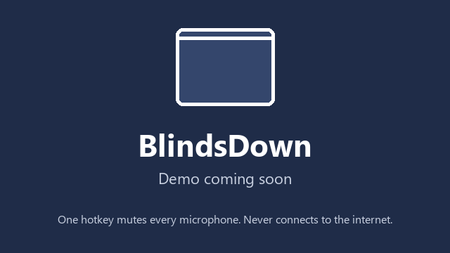

# BlindsDown

**One hotkey mutes every microphone on your Windows PC, keeps them muted, and puts them back exactly as they were. It never connects to the internet.**



## What it does

BlindsDown is a small app that lives in the notification area (the system tray). Press
**Ctrl+Alt+Shift+M** and every microphone is muted: built-in, USB, Bluetooth, and virtual ones such as
SteelSeries Sonar or Voicemeeter. While the lock is on, BlindsDown watches: if anything unmutes a mic, or
a new mic is plugged in, it is muted again straight away and you get an alert. Press the hotkey again
and every mic goes back to exactly how it was before, and BlindsDown tells you so.

It also shows you, live, which app is using your microphone ("Discord is using your microphone"), tells
you when an app has used your camera, and keeps a private history on your PC. The lock itself is for
microphones only for now; locking cameras comes in the next stage.

## Features

**Available now (Stage 1)**

- **Hotkey lock:** one key combination (default Ctrl+Alt+Shift+M) mutes every microphone, including virtual ones. You can change the hotkey, click the tray icon instead, or use the [command line](#command-line).
- **Guard:** while locked, a mic that gets unmuted (by an app, by you, by Windows) is muted again immediately, with an alert. It never gives up. If something unmutes a mic 5 times within a minute, a red warning tells you that something keeps unmuting it.
- **New mics are muted on arrival:** plug in a USB mic or webcam while locked and its mic is muted as soon as Windows sees it.
- **Exact restore with a restore report:** unlocking only undoes what BlindsDown changed. A mic you had muted yourself stays muted. Afterwards you see a short report, e.g. "All 3 microphones restored exactly as before."
- **Crash recovery and emergency restore:** every change is written down before it is made. If BlindsDown is closed unexpectedly while locked, it asks on the next start whether to keep the lock or restore your mics. `BlindsDown.exe --restore` puts everything back, even after you deleted BlindsDown and downloaded it again.
- **Live "which app uses my mic" alerts:** a popup when an app starts using a microphone, including apps hiding behind virtual devices (Discord using the SteelSeries Sonar virtual microphone). "Always allow" silences apps you trust. While the mics are locked, every app that opens one shows a popup, so nothing listens unnoticed.
- **Camera usage alerts (best effort):** a popup when an app has used your camera. These come from Windows' own usage records, which can lag by about 10 seconds, and some newer Windows 11 builds have stopped updating them. Don't rely on them alone.
- **Unmissable indicator and sounds:** a red "MIC LOCKED" badge on every monitor, a different tray icon (the blinds are down), a big on-screen confirmation, and a short tone on lock and unlock. By default the badge, the on-screen confirmation and BlindsDown's popups are hidden from screen sharing and recordings (Settings: "Hide BlindsDown from screen sharing and recordings").
- **Honest protection labels:** Settings > Devices shows for every microphone whether it has hardware mute or only software mute.
- **Exclusions:** leave chosen microphones out of the lock. Exclusions are per device: if you have two identical mics (say, two of the same USB mic or Bluetooth headset), excluding one leaves the other one locked.
- **Local history:** which app used your microphone or camera, and when. Stored only on your PC. Entries older than 30 days are deleted automatically (you can change that), and you can turn history off or clear it.

**Coming next**

- **Device-level disable of microphones:** the same switch as Windows Sound settings' "Don't allow", which is stronger than mute.
- **Camera lock:** cameras disabled at the device level by a small helper service (installed once, one admin prompt).
- **Live camera usage monitoring:** which app is using your camera the moment it starts, straight from Windows' camera system instead of its usage records.
- **A lock and unlock timeline in Activity.** Until then, every lock and unlock is written to the log file.
- **An installer**, in addition to the portable zip.

## This app never connects to the internet

**BlindsDown has no network code at all.** No update checks, no telemetry, no crash reports, no ads,
no accounts. This is not just a promise; it is enforced, and you can check it yourself.

How it is enforced:

1. **Compile-time ban.** Every API that can reach the network (all of `System.Net`, web browser controls,
   image boxes that can load URLs, help viewers, sound players that accept URLs, starting other programs,
   creating COM objects by name) is listed in [`BannedSymbols.txt`](BannedSymbols.txt). Using one is a
   **build error**, so such code can't even be compiled.
2. **CI scan of the built program.** On every change, an automated test
   ([`tests/BlindsDown.Tests/NoNetwork`](tests/BlindsDown.Tests/NoNetwork)) reads the compiled program and
   fails if it references any networking code, calls into any Windows DLL outside a short list of
   non-networking system DLLs, creates any COM object outside a two-entry list, starts a program from
   anywhere except one audited place that can only open Windows Settings pages, or uses tricks that would
   hide code from the scan (loading code or calling methods by name while running).
3. **Runtime tripwire.** If networking code is ever loaded into BlindsDown while it runs, it shows a red
   alert that stays until you close it, and writes it to the log file.
4. **Zero third-party runtime packages.** Everything in BlindsDown.exe is either this repository's code or
   Microsoft's .NET runtime. The CI scan checks that too.

Honest details:

- The downloadable BlindsDown.exe contains the whole .NET runtime so that you don't have to install
  anything, and that runtime includes .NET's own networking libraries. They are on disk inside the exe but
  BlindsDown never uses or loads them, which is exactly what points 1 to 3 check.
- Windows itself may contact Microsoft *about* BlindsDown.exe: SmartScreen checks a newly downloaded program
  the first time you run it, Microsoft Defender may look it up, and if it ever crashed, Windows Error
  Reporting could offer to send a report. Those connections are made by Windows' own programs (depending on
  your Windows privacy settings), not by BlindsDown.exe, so the checks below don't show them under
  BlindsDown.exe and a firewall rule for BlindsDown.exe doesn't affect them.

### Verify it yourself

You don't have to trust us. Any of these works:

- **Block it in Windows Firewall.** BlindsDown works exactly the same with all network access blocked.
  In PowerShell **as administrator**, with the real path to your BlindsDown.exe (in File Explorer,
  Shift+right-click BlindsDown.exe > **Copy as path**):

  ```powershell
  New-NetFirewallRule -DisplayName "Block BlindsDown" -Direction Outbound -Action Block -Program "C:\Users\YourName\AppData\Local\Programs\BlindsDown\BlindsDown.exe"
  ```

  To remove the rule later:

  ```powershell
  Remove-NetFirewallRule -DisplayName "Block BlindsDown"
  ```

- **Resource Monitor.** Press Win+R, type `resmon`, press Enter, open the **Network** tab. BlindsDown.exe
  never appears under "Processes with Network Activity" or "TCP Connections".
- **TCPView** (free, from Microsoft Sysinternals). Type `BlindsDown` in its filter box: no rows, ever.
- **PowerShell.** While BlindsDown runs, these print nothing (or "No matching ... objects found"):

  ```powershell
  Get-NetTCPConnection -OwningProcess (Get-Process BlindsDown).Id
  Get-NetUDPEndpoint -OwningProcess (Get-Process BlindsDown).Id
  ```

- **A note on file shares.** Files on network drives and shares (SMB) are fetched by Windows' own "System"
  process, not by the program that asked for them, so the per-process checks above would never show such
  traffic under BlindsDown.exe. That's why BlindsDown never opens network paths at all: for an app that
  runs from a network drive, it skips reading that app's icon and version details.
- **Check that your download is the real one.** Every release lists SHA-256 checksums in `SHA256SUMS.txt`.
  In PowerShell, in your Downloads folder:

  ```powershell
  Get-FileHash .\BlindsDown-1.0.0-win-x64.zip -Algorithm SHA256
  ```

  The hash must match the line for that file in `SHA256SUMS.txt` (use your version number).
- **Check that it was built from this source code.** Every release zip has a signed GitHub build
  attestation that proves it was built by this repository's release workflow, not uploaded by hand. With the
  [GitHub CLI](https://cli.github.com/) installed:

  ```powershell
  gh attestation verify .\BlindsDown-1.0.0-win-x64.zip --repo Giantflypizza/BlindsDown
  ```

- **Read and build the code yourself.** See [Build from source](#build-from-source). The rules above live in
  [`BannedSymbols.txt`](BannedSymbols.txt) and [`tests/BlindsDown.Tests/NoNetwork`](tests/BlindsDown.Tests/NoNetwork).

## Install

1. Open the [latest release](../../releases/latest) and download the zip for your PC:
   - `BlindsDown-<version>-win-x64.zip` for almost all Windows PCs (Intel or AMD).
   - `BlindsDown-<version>-win-arm64.zip` for Windows on ARM (for example Snapdragon laptops).
2. Unzip it into a folder you'll keep, for example `%LocalAppData%\Programs\BlindsDown` (paste that into
   the File Explorer address bar). Don't run it from inside the zip or from Downloads: "Start with Windows"
   remembers where the exe is.
3. Double-click **BlindsDown.exe**. Nothing else needs to be installed; .NET is built in. No admin rights needed.

**"Windows protected your PC" (SmartScreen).** BlindsDown is not code-signed yet (signing certificates cost
money; free signing for open-source projects is planned). Windows warns about any new unsigned app. Click
**More info**, then **Run anyway**. If you'd like to be sure first, check the download as described in
[Verify it yourself](#verify-it-yourself).

**Pin the tray icon (Windows 11).** Windows 11 hides new tray icons behind the **^** arrow. To keep the
BlindsDown icon visible: Settings > Personalization > Taskbar > **Other system tray icons** > turn
**BlindsDown** on. Or drag the icon from the **^** menu onto the taskbar. The welcome window has a button
that opens this page.

**Start with Windows.** Tick "Start with Windows" in the welcome window or in Settings. If you turned
BlindsDown off in Task Manager > Startup apps, BlindsDown never overrides that: Settings tells you and has a
button that opens that page, so you can turn it back on there.

Requirements: Windows 11, x64 or ARM64. Windows 10 works but is no longer supported by Microsoft for most editions.

## Usage

| To | Do this |
|---|---|
| Lock all microphones | Press **Ctrl+Alt+Shift+M**, or left-click the tray icon |
| Unlock | Press the hotkey again, or left-click the tray icon |
| See who is using the mic or camera | Right-click the tray icon > **Activity** |
| Change hotkey, indicator, sounds, exclusions | Right-click the tray icon > **Settings** |
| Lock or unlock from a script or shortcut | See [Command line](#command-line) |

Every lock and unlock is confirmed by a big message in the middle of the screen and by the tray icon, and
with a short tone (falling = locked, rising = unlocked) unless you turned sounds off in Settings. Every lock
and unlock is also written to the log file.

**Unlocks that don't come from you.** If BlindsDown is unlocked from the command line or by another
program (not by your hotkey or tray click), it always plays the unlock tone, even with sounds off, and shows
a red "Unlocked by another program" popup that stays until you close it. So nothing can unlock your mics
quietly.

What the indicator means:

| You see | Meaning |
|---|---|
| Red **MIC LOCKED** badge on every monitor, tray icon with the blinds down | Every microphone (except any you excluded) is muted, and BlindsDown checked it. |
| Amber **PARTIALLY LOCKED** badge | At least one microphone could not be muted. The alert says which one and why. Don't rely on the lock until it's red. |
| No badge, tray icon with the blinds up | Unlocked. Your microphones are as you left them. |

**Popups.** When an app starts using a microphone or the camera, you get a small popup in the bottom-right
corner that never steals focus from what you're doing. Click **Always allow** for apps you trust (they still
appear in the history), or turn popups off in Settings. For browsers (Edge, Chrome, Firefox, Brave, Opera,
Vivaldi, Arc) the popup adds "Windows doesn't say which website."

**While your microphones are locked, popups work differently,** so nothing listens unnoticed:

- Every app that opens a microphone shows a popup, even apps you always allow and even if you turned popups off.
- The popup says whether that microphone is protected. If it is muted, the app "only hears silence" (with a
  note when the mic has only software mute, which apps using exclusive mode can get around). If the mic is
  excluded or could not be locked, you get a red warning instead.
- These popups stay until you close them. If the same app opens the same microphone again, the popup that's
  already there is updated instead of a new one piling up.
- If apps already had a microphone open when you locked, one popup lists them: they now only hear silence.
  Apps you always allow are left out of that list.

**Exiting while locked.** Tray menu > **Exit** asks whether to **Unlock and exit** or **Exit and stay
locked** (the lock simply continues the next time BlindsDown starts). If something can't be restored
exactly when you unlock and exit (a mic was unplugged, or unmuting it failed), BlindsDown shows you what
happened before it closes and offers to keep running until the mic is plugged back in. A mic that was
unplugged when you unlocked is only restored while BlindsDown is running.

## Command line

You can also control BlindsDown from PowerShell, a script or a shortcut. In PowerShell, go to the folder
with BlindsDown.exe and run it with one option, for example:

```powershell
cd "$env:LOCALAPPDATA\Programs\BlindsDown"
.\BlindsDown.exe --lock
```

| Option | What it does |
|---|---|
| `--lock`, `--unlock`, `--toggle` | Lock, unlock, or switch between the two, in the BlindsDown that is running. If BlindsDown isn't running, it starts and then does it. |
| `--restore` | Emergency restore: undoes every change BlindsDown recorded and shows you what it did. It works even with a freshly downloaded BlindsDown.exe, because the record lives in `%LocalAppData%\BlindsDown`, not next to the exe. If BlindsDown is running, this simply unlocks it. |
| `--snapshot [file]` | Writes the state of every microphone to a text file. It only reads; nothing is changed. Handy for comparing before and after a lock. |
| `--selftest [file]` | Locks, checks that every microphone is really muted, unlocks, and checks that everything is exactly as before. It mutes your mics for about a second. Close the tray app first (tray menu > **Exit**). Writes a report that ends with "RESULT: PASS" or "RESULT: FAIL". |

Without a file name, `--snapshot` and `--selftest` save their file in `%LocalAppData%\BlindsDown`.
BlindsDown does its work in the background, so the file appears a moment after PowerShell returns.

An unlock with `--unlock`, `--toggle` or `--restore` while BlindsDown is running counts as an unlock by
another program: tone and red popup, as described in [Usage](#usage).

## If something looks wrong

- **A microphone is still muted after unlocking.** If the restore report said it was not connected, plug it
  back in while BlindsDown is running: it is restored by itself. Otherwise, unmute it in Windows: press
  Win+R, type `mmsys.cpl` and press Enter (or Settings > System > Sound > **More sound settings**). Open the
  **Recording** tab, double-click the microphone, open **Levels** and click the crossed-out speaker icon next
  to the slider. The restore report after unlocking tells you if BlindsDown left something alone on purpose
  (for example because you changed it yourself while locked).
- **BlindsDown closed or crashed while locked.** Start it again. It notices the unfinished lock and asks
  whether to **Restore my devices** or **Keep locked**.
- **BlindsDown is gone (deleted) and a mic is still muted.** Download it again, unzip it anywhere, open
  PowerShell in that folder and run `.\BlindsDown.exe --restore`. It finds its record in
  `%LocalAppData%\BlindsDown`, undoes exactly what it changed and shows you what it did. If you deleted that
  folder too, unmute the mic in Sound settings as described above.
- **You see "Unlocked by another program".** Something ran `BlindsDown.exe --unlock`, `--toggle` or
  `--restore`, or another program told BlindsDown to unlock. If that wasn't you (or a script or shortcut you
  set up), check what's running on your PC. The log file shows when it happened.
- **The hotkey does nothing.** Some fullscreen games and apps running as administrator swallow hotkeys.
  Click the tray icon instead. If another app already uses the same combination, Settings tells you; pick
  a different one.
- **Logs for a bug report.** BlindsDown keeps a small log at `%LocalAppData%\BlindsDown\blindsdown.log`
  (paste `%LocalAppData%\BlindsDown` into the File Explorer address bar). It contains what BlindsDown did
  (including every lock and unlock), device names, app names and the paths of their exe files. Those paths
  usually include your Windows user name. It never contains keystrokes, window titles or audio. Please read
  it before attaching it to an issue.

## Limits

BlindsDown makes accidental and sneaky microphone use much harder and much more visible. It is not magic.
Please read these:

- **Software can't beat malware with administrator rights.** Malware like that can undo anything any app does.
- **Malware running as you can unlock BlindsDown**, for example by faking the hotkey. You would still notice:
  every unlock shows the on-screen message and changes the tray icon, and plays the unlock tone if sounds
  are on. An unlock from the command line or another program always plays the tone and leaves a red popup
  until you close it. Every lock and unlock is written to the log file.
- **Only a physical camera cover or a hardware microphone switch is certain.** If it really matters, use one.
- **Software mute can be bypassed** by apps that open a microphone in "exclusive mode", on microphones that
  have no hardware mute. Settings > Devices shows which of your mics have only software mute, whether
  you're locked or not.
- **Pro-audio apps that use ASIO or kernel streaming** talk to the sound card directly and bypass mute.
- **A newly plugged-in microphone is usable for a split second** before BlindsDown mutes it.
- **A mic that was unplugged when you unlocked** is only restored if you plug it back in while BlindsDown
  is running. Otherwise unmute it in Sound settings.
- **Hotkeys can be swallowed** by some fullscreen games and apps running as administrator. Use the tray
  click; every toggle is confirmed by an on-screen message and the tray icon, so you always know whether it worked.
- **Browsers:** Windows only tells BlindsDown that, say, Microsoft Edge uses the mic, not which website.
  The popup says so.
- **The lock affects all users of the PC.** Microphone mute is a machine-wide setting in Windows.
- **Cameras aren't locked yet.** That comes in the next stage. Camera alerts are best effort until then:
  they come from Windows' own usage records, which can lag by about 10 seconds, and some newer Windows 11
  builds have stopped updating them.

## Build from source

You only need this if you want to check or change the code. No C# experience is needed to build it.

1. **Install the .NET 10 SDK** (Microsoft's free C# tools). In PowerShell:

   ```powershell
   winget install Microsoft.DotNet.SDK.10
   ```

   Close and reopen PowerShell afterwards.
2. **Get the code:** `git clone` this repository, or use the green **Code** button > **Download ZIP** and unzip it.
3. **Open PowerShell in the project folder** (the one containing `BlindsDown.slnx`) and run these commands:
   - `dotnet build` compiles everything (warnings count as errors).
   - `dotnet test` runs the automated tests, including the no-network scan.
   - `dotnet run` starts BlindsDown from the source code.

   ```powershell
   dotnet build BlindsDown.slnx
   dotnet test BlindsDown.slnx
   dotnet run --project src/BlindsDown
   ```

4. **Make your own BlindsDown.exe** (one self-contained file, like the release):

   ```powershell
   dotnet publish src/BlindsDown/BlindsDown.csproj -c Release -r win-x64 -o publish/win-x64
   ```

   The exe appears in `publish\win-x64`. Use `-r win-arm64` for ARM PCs.

New to C#? `src/BlindsDown.Core` is the plain logic (locking, restoring, history) and is the easiest place to
start reading. `src/BlindsDown` is the Windows app around it. Any editor works; Visual Studio Code with the
"C# Dev Kit" extension or the free Visual Studio Community add debugging. The design is explained in
[docs/DESIGN.md](docs/DESIGN.md), and [docs/TESTING.md](docs/TESTING.md) explains the tests and the manual test checklist.

## Privacy of BlindsDown's own data

Everything BlindsDown stores is a plain file in `%LocalAppData%\BlindsDown` on your PC, inside your own
Windows user profile (other standard users of the PC can't read it; administrators can). Nothing is ever
sent anywhere (there is no code that could send it).

| File | What's in it |
|---|---|
| `settings.json` | Your settings: hotkey, indicator, excluded microphones, always-allowed apps |
| `history.jsonl` | Which app used a microphone or the camera, and when, with the app's name and exe path. Only if history is on. Entries older than the retention period (30 days by default) are deleted automatically when BlindsDown starts and every 6 hours. |
| `blindsdown.log` (and `.log.old`) | What BlindsDown did, including every lock and unlock, for troubleshooting (about 1 MB at most). Contains device names, app names and exe paths. |
| `lock-journal.json` | Only while locked: what to restore on unlock |
| `pending-restores.json` | Only after an unlock while a microphone was unplugged: what to restore when it's plugged back in while BlindsDown runs. Deleted once that's done. |
| `.bak` and `.tmp` copies of the files above | Safety copies made while saving, so a crash or power cut can't damage them |
| `snapshot-*.txt`, `selftest-*.txt` | Only if you ran `--snapshot` or `--selftest` without a file name: your microphones' names and states |

BlindsDown never records or listens to audio. It only sees *that* an app uses a microphone or camera.

To delete your data: **Clear history** in Settings > History deletes all of it. Turning history off asks
whether to also delete the history you already have. To remove everything:

1. Unlock.
2. If the last restore report said a microphone was not connected, plug it back in with BlindsDown running
   (or unmute it in Sound settings), so nothing is left muted.
3. Turn off "Start with Windows" and exit BlindsDown.
4. Delete the `%LocalAppData%\BlindsDown` folder and the folder where you put BlindsDown.exe.

## License

[MIT](LICENSE). Free to use, change and share. Security issues: see [SECURITY.md](SECURITY.md).
